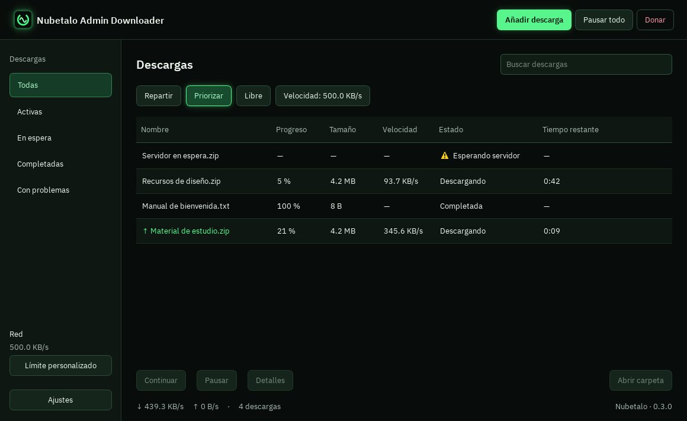

# Nubetalo Admin Downloader

Gestor de descargas gratuito para **Windows x64**, sin anuncios, cuentas ni telemetría.
Versión **0.3.0**.

[Descargar instalador](https://github.com/juanrrrhlm-commits/nubetalo-admin-downloader/releases/latest) · [Privacidad](PRIVACY.md) · [Licencias](LEGAL.md) · [Seguridad](SECURITY.md)

## Funciones

- Enlaces HTTP/HTTPS, archivos `.torrent` y enlaces magnet; torrents v1/v2 e híbridos.
- Pausa, reintentos y recuperación con comprobaciones de identidad del origen.
- Reparto del presupuesto de velocidad entre tareas activas y prioridad desde la ventana principal.
- Límites globales y por descarga, horarios, selección de archivos y tiempo compartiendo.
- Avisos concretos del servidor al pasar el cursor por el icono de advertencia.
- Tiempo estimado por años, meses, semanas, días u horas; minutos:segundos bajo una hora.
- Sonido y aviso compacto al terminar, con opciones para desactivarlos por separado.
- Cola y estado privado protegidos por el usuario de Windows.

## Instalación y uso

1. Descarga `Nubetalo Admin Downloader-Setup-0.3.0.exe` desde Releases.
2. Sigue el asistente; el acceso directo del escritorio viene seleccionado. No requiere administrador.
3. Pulsa **Añadir descarga**, pega enlaces o abre un torrent y elige destino.
4. **Velocidad** fija el presupuesto total en MB/s (8Mbps = 1MB/s). **Repartir** lo distribuye entre tareas activas; **Priorizar** da a las seleccionadas cuatro veces la cuota normal. **Libre** quita el límite general, conservando horarios y límites por tarea.

El máximo de tareas simultáneas se ajusta en Configuración. Si permites una sola conexión por servidor, los enlaces a ese mismo servidor se descargan por turnos. La aplicación utiliza la conectividad disponible; no aumenta la velocidad contratada ni combina adaptadores de red.

Cerrar la ventana minimiza a la bandeja por defecto. **Salir** cierra el programa.
El inicio con Windows y las asociaciones de torrents/magnet son opcionales.

## Recuperación y límites

La reanudación segura depende de que el servidor permita comprobar que el archivo no cambió. Si no admite rangos o cambia el contenido, puede ser necesario reiniciar. Los archivos HTTP muestran verificación criptográfica si aportas un SHA-256; BitTorrent verifica sus piezas. No se ejecutan ni extraen archivos al terminar.

Los avisos HTTP429/503 o de rangos no admitidos describen evidencia real. Una transferencia lenta por sí sola no demuestra que el servidor imponga un límite.

Los meses se estiman como30 días y los años como365 días. No se muestran unidades cero.

El estado se guarda en `%LOCALAPPDATA%\Nubetalo Admin Downloader`, cifrado por DPAPI desde0.3. No es portable entre perfiles Windows. Las descargas y tus torrents originales siguen siendo archivos normales. Consulta [Privacidad](PRIVACY.md) antes de compartir diagnósticos.

## Aportes y soporte

**Donar** abre PayPal, donde eliges un aporte voluntario. Ninguna función está bloqueada por pago.
Soporte: **juanrrrhlm@gmail.com**. No envíes contraseñas, códigos ni enlaces privados.

## Código y licencias

AGPL-3.0-or-later; ver [LICENSE.txt](LICENSE.txt), [COPYRIGHT.md](COPYRIGHT.md) y [avisos de terceros](THIRD_PARTY_NOTICES.md).
La marca conserva el anillo/onda de Nubetalo Sound, recoloreado en verde vivo con halo y esquinas transparentes. El motor de audio no forma parte de esta aplicación.

Se entregan fuentes correspondientes e instrucciones en [BUILD.md](BUILD.md), con las fuentes de Qt/PySide junto a cada versión. [Revisión de seguridad](docs/SECURITY_AUDIT.md).

Probado en Windows11 x64. Windows10 es un objetivo de compatibilidad sin verificación en equipo independiente. El instalador aún no tiene firma digital comercial; verifica SHA256SUMS.txt de la versión descargada.
